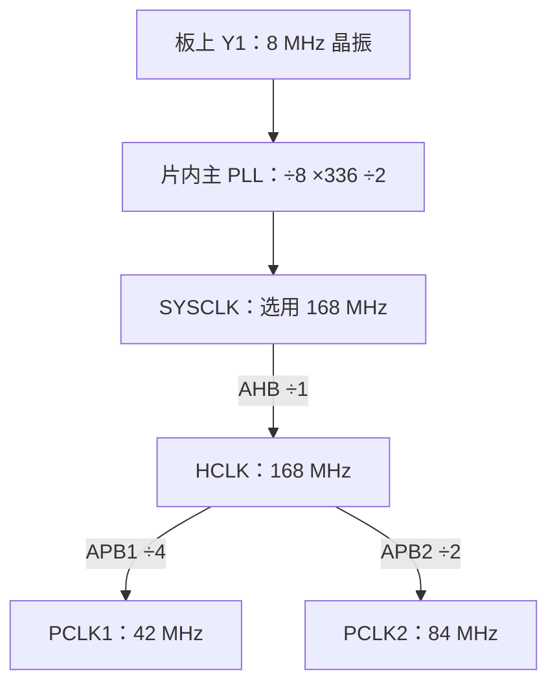

# F407 开发板详解：从本地原理图读到官方手册

整理日期：2026-09-30。

对象是本地文件标为“普中 F407-T100”的开发板原理图，图内主控 U1 明确标注 **STM32F407ZGT6**，图纸日期为 2020-12-24。下面关于 LED、按键、接口的接线结论针对这份图；其他 F407 开发板可能采用不同引脚。

先理解一句话：**开发板把 MCU 和它需要的配套电路接好，让你可以给它供电、下载程序，并通过灯、按键和接口观察程序的效果。**

## 1. 官方手册与开发板原理图分别管什么

| 资料 | 回答的问题 | 本次阅读位置 |
|---|---|---|
| [本地开发板原理图](../03_作业_2026-09-29/普中F407-T100开发板原理图_STM32F407ZGT6.pdf) | 板上装了哪些器件？哪根脚接哪盏灯？晶振是多少？ | 单页，按红色分区读 |
| [DS8626：F407 数据手册](../03_作业_2026-09-29/STM32F407ZGT6数据手册_ST.pdf)，Rev 12 | 芯片有什么功能？引脚是什么？电压、容量和频率规格是什么？ | 第 16、20、22、25、45、73–76、121、186 页 |
| [RM0090：STM32F4 参考手册](./参考手册/RM0090_Rev22_STM32F4参考手册.pdf)，Rev 22 | 芯片内各模块如何运行和配置？寄存器各位是什么意思？ | 第 2 章；第 7 章的 F405/407 时钟；第 8 章 GPIO |
| [PM0214：Cortex-M4 编程手册](./参考手册/PM0214_Rev10_Cortex-M4编程手册.pdf)，Rev 10 | CPU 怎样执行指令、访问存储器、处理异常？ | 第 2 章编程模型与异常 |

例如“PF9 能做哪些功能”查 ST 手册，“这块板把 PF9 接到了 LED0”查开发板原理图。ST 不规定每家开发板的 LED 接线。

官方原文：[DS8626](https://www.st.com/resource/en/datasheet/stm32f407zg.pdf)、[RM0090](https://www.st.com/resource/en/reference_manual/dm00031020-stm32f405415-stm32f407417-stm32f427437-and-stm32f429439-advanced-armbased-32bit-mcus-stmicroelectronics.pdf)、[PM0214](https://www.st.com/resource/en/programming_manual/pm0214-stm32-cortexm4-mcus-and-mpus-programming-manual-stmicroelectronics.pdf)。本文页码对应上表保存的版本。

## 2. 开发板、芯片、内核是三层

```text
F407 开发板：你拿在手里的一整块电路板
  ├─ U1：STM32F407ZGT6 主控芯片
  │    ├─ Cortex-M4 内核：执行程序指令
  │    ├─ 片内 Flash：保存程序和需要保留的数据
  │    ├─ 片内 SRAM：保存运行时变量、缓冲区、堆栈
  │    ├─ GPIO、TIM、USART、SPI、I²C、ADC 等外设模块
  │    └─ RCC、总线等配套模块
  └─ 芯片之外：稳压器、晶振、复位按钮、LED、接口、扩展存储器等
```

原理图中间那块写着“CPU”的黄色大矩形，实际画的是整颗 **STM32F407ZGT6 MCU** 的引脚符号。它里面已经集成 CPU、存储器和各种外设，并非只有 CPU。

芯片内部框图中的 GPIO、USART、TIM 是芯片内的硬件模块。它们不等于板上各焊着一颗独立的 GPIO 芯片、USART 芯片或 TIM 芯片。

## 3. STM32F407ZGT6 这串名字怎样读

| 字段 | 本型号中的含义 |
|---|---|
| STM32 | ST 的 Arm 32 位微控制器系列 |
| F407 | 器件子系列，F4 家族中的 F407 |
| Z | 144 个封装引脚 |
| G | 1024 KB，即 1 MB 片内 Flash |
| T | LQFP 封装，四边引出引脚的方形扁平封装 |
| 6 | 工业温度等级，−40～85 ℃ |

先理解这些规格的意义：

- **32 位：** 内核通用寄存器和主要运算的数据宽度为 32 位。它也能处理字节、半字数据。
- **最高 168 MHz：** 芯片允许配置到的最高主频，不表示一上电就已经运行在这个频率。
- **1 MB Flash：** 下载进去的程序通常保存在这里，断电后仍保留。
- **192 KB SRAM：** 包含 112 KB SRAM1、16 KB SRAM2、64 KB CCM 数据 RAM，另有 4 KB 备份 SRAM。普通 SRAM 在失去供电后不能保留内容。
- **144 脚：** 包含供电、地、复位、启动和时钟等引脚。LQFP144 型号的 GPIO 数量为 114，不能把 144 全当作普通 I/O。

来源：DS8626 第 16、22、186 页。64 KB CCM 只能由 CPU 访问，不能作为 DMA 直接访问的缓冲区，见 RM0090 第 2.1 节。

## 4. 先用“分区”读整张原理图

| 图中位置 | 分区 | 在板上做什么 |
|---|---|---|
| 中间 | CPU / U1 | 主控芯片与供电、时钟相关连接 |
| 左下 | POWER | 将 5 V 转为板上所需的 3.3 V |
| U1 下方 | 8 MHz、32.768 kHz | 两套外部晶振电路 |
| 底部中间 | BOOT、RESET、JTAG | 启动选择、复位、下载调试 |
| 右下 | LED、KEY | 指示灯和用户按键 |
| 左下角 | USB USART | USB 转串口芯片 CH340C 及相关接口 |
| 右上 | USB Slave | MCU 自己的 USB 数据接口 |
| 右侧 | SPI FLASH、EEPROM、TF Card、NRF24L01 | 存储器与扩展接口 |
| 左上 | IO / P1、P2 | 把主控信号引到排针，方便连接外部电路 |

读图时，先挑一个熟悉的器件，比如 LED，沿它的信号名追到 MCU。原理图为了整洁，会把同一根电气网络分开画：**同名网标表示同一连接网络**。交叉线是否连通，要看连接点。

四类标记要分清：

| 例子 | 是什么 |
|---|---|
| U1、R12、C28、DS0 | 元件位号：分别定位芯片、电阻、电容、LED |
| PF9 | MCU 的逻辑引脚名：F 端口的第 9 位 |
| 21 | 在本款 LQFP144 封装上的物理脚号 |
| LED0 | 开发板设计者给这根信号网络起的名字 |

因此，**PF9、21、LED0 可以描述同一处连接的不同方面**。排针 P1/P2 上的编号又是连接器自己的脚号，需要通过信号名与 MCU 对应。

### 一根脚后面为什么跟着一长串名称

例如图中的 `PF9/TIM14_CH1/FSMC_CD/ADC3_IN7`，描述的是同一个物理引脚的多种可选功能：PF9 表示普通 GPIO 身份；TIM14_CH1 是定时器通道功能；FSMC_CD 属于外部存储接口相关功能；ADC3_IN7 是模拟采样通道功能。

这些名称不表示有四根脚。程序通过引脚模式、复用配置及外设设置选择所需功能。本板把它接到了 LED0，读这块板的 LED 电路时，先关注 PF9 的 GPIO 用法。以后把该脚改成其他用途，还必须考虑板上已经接着 LED 这件事。

## 5. 电源：为什么 USB 是 5 V，MCU 却用 3.3 V


沿图从左到右看：`VCC5` 接稳压器 V1 的 IN，V1 型号为 `1117-3.3`，OUT 接到 `VCC3.3`。所以板上的主要供电路径是：

```text
5 V 输入 → 1117-3.3 稳压器 → 3.3 V 电源网络 → MCU 及其他器件
```

周围电容为电源提供滤波、稳定及瞬态支持。主控周围许多标为 `104` 的电容是 100 nF，常用于去耦：芯片内部开关动作会带来瞬时电流需求，附近的电容有助于减小电源扰动。

芯片电源名称的含义：

| 名称 | 作用 |
|---|---|
| VDD / VSS | 主电源与地，本图分别接 3.3 V 与 GND |
| VDDA / VSSA | 模拟相关电路的电源与地 |
| VREF+ | ADC、DAC 等使用的参考电压端 |
| VBAT | 在主电源不在时，为备份域提供电源，能否保持还取决于供电与配置 |
| VCAP_1 / VCAP_2 | 内部稳压器的外部电容连接端；本图接 C40/C41 |

芯片内部还有给内核使用的约 1.2 V 电源域。看到内部框图写 1.2 V，不代表外部 VDD 也应接 1.2 V。这里由芯片内部稳压环节处理。

STM32F407 的正常应用 VDD 范围为 1.8–3.6 V，本板采用 3.3 V。部分 I/O 的“5 V 容忍”是特定引脚、模式和条件下的输入能力，不能据此给 VDD 直接接 5 V。

来源：板图 POWER、U1 供电部分；DS8626 第 3.14–3.17 节，第 25–31 页。

## 6. 晶振与时钟：为什么有 8 MHz，又说芯片是 168 MHz


图中的 Y1 是 8 MHz 晶体，接在 `OSC_IN` 与 `OSC_OUT` 之间，配合芯片内部振荡电路和两侧电容产生时钟。它们在本型号中对应 PH0、PH1，即物理第 23、24 脚。

另一只 Y2 为 32.768 kHz 晶体，接到 PC14、PC15，主要用于 RTC 等低速计时需求。32.768 kHz 等于每秒 32768 个周期，可以通过分频得到适合计时的频率。

**时钟提供节拍，程序决定做什么。** 168 MHz 表示每秒 1.68 亿个时钟周期；一条指令需要多少周期，与指令、流水线及存储器访问等因素有关。

这块板有 8 MHz 晶振，不代表 CPU 只能以 8 MHz 工作。芯片内部的 PLL 可以进行分频和倍频，典型计算是：

```text
HSE 8 MHz ÷ M(8) = 1 MHz
1 MHz × N(336)   = 336 MHz   ← PLL 内部 VCO 频率
336 MHz ÷ P(2)   = 168 MHz   ← 主 PLL 的系统时钟输出
```

此时再把系统时钟来源选成这路 PLL 输出，SYSCLK 才是 168 MHz。复位后芯片默认使用片内 HSI 16 MHz；升到 168 MHz 需要软件完成配置。

### 先读主线，再读分支



三个名字对应不同位置：SYSCLK 是系统选择器的输出；HCLK 是经过 AHB 分频器后的输出；PCLK1/2 是再由 HCLK 分频得到的两组外设时钟。

F407 的四个主要振荡源是 HSI、HSE、LSI、LSE。SYSCLK 可选 HSI、HSE 或主 PLL 输出；LSI/LSE 服务于低速需求。F407 还有音频用 PLLI2S。不能把其他型号的 IRC48M、PLLSAI 等直接套到 F407。

| 时钟/模块 | 本例频率 | 怎么理解 |
|---|---|---|
| SYSCLK、HCLK | 168 MHz | 本例 AHB 除以 1，所以两者相等 |
| APB1 / PCLK1 | 42 MHz | TIM2、CAN、部分串口等所在总线域 |
| APB2 / PCLK2 | 84 MHz | USART1 等所在总线域 |
| TIM2 输入时钟 | 84 MHz | F407 的 APB 分频大于 1 时，定时器时钟为 2×PCLK |
| SysTick | 可选 HCLK 或 HCLK/8 | 用于系统节拍等，需要再配置计数周期 |

PLL 的 Q 输出是另一条分频支路，本例 `336÷7=48 MHz`，可供 USB OTG FS 等使用。它并非另一颗独立的“USB PLL”。GPIO 的总线频率也不等于引脚能以相同频率翻转。

来源：板图 Y1/Y2；DS8626 第 25、45 页；RM0090 第 7.2 节，第 216–220 页。实际改时钟还须满足供电、Flash 等待周期和各级频率上限，本节先理解关系，不提供整套初始化程序。

## 7. 芯片内部框图怎么读

先找 CPU 内核，再看它访问谁：

| 模块 | 用途 | 可联想到的任务 |
|---|---|---|
| Cortex-M4 | 执行指令、进行运算、控制程序流程 | 判断按键是否按下 |
| Flash | 保存程序和常量等 | 保存“按键控制灯”的程序 |
| SRAM | 保存运行中的变量和堆栈等 | 保存按键状态、计数值 |
| GPIO | 读取或输出引脚电平 | 读按键、控制 LED |
| TIM | 硬件计数、定时、PWM 等 | 按固定周期产生事件 |
| USART、SPI、I²C | 不同通信接口控制器 | 和电脑、存储器、传感器交换数据 |
| ADC / DAC | 模拟量与数字量之间转换 | 采集传感器电压、输出模拟电压 |
| DMA | 按配置搬运数据 | 将外设数据搬到 SRAM，减少 CPU 逐次处理 |
| NVIC | 管理中断响应 | 事件发生时转入相应服务程序 |
| RCC | 管理时钟、复位等 | 启用 GPIOF 的时钟 |

这些模块需要交换信息，总线提供访问通路。例如 CPU 对 GPIO 控制寄存器的写入，会沿内部总线送到 GPIO 模块。

这里的“地址”既可以指存储程序和变量的存储器，也可以指硬件模块的控制寄存器。**寄存器可以先理解为硬件的设置项或状态项**：有的决定工作模式，有的反映输入电平，有的控制输出电平。

F407 的 GPIO 挂在 AHB1，TIM2 挂 APB1，USART1 挂 APB2。看到 APB 桥，可以把它理解为跨到相应总线域的访问通道。SYSCLK/HCLK/PCLK 图描述节拍，总线矩阵图描述访问关系，读图时分别追踪。

来源：DS8626 第 20 页框图、第 73–76 页地址表；RM0090 第 2.1 节。芯片带有某个接口控制器，不代表本开发板已经装好了完整接口：例如以太网还需相应 PHY 和连接电路，CAN 总线通常还需收发器。NRF24L01 分区在此图中是模块连接座。

## 8. 看懂一盏灯，就能把原理图和芯片联系起来


从左边 LED 分区开始：

1. `VCC3.3` 是 3.3 V 电源。
2. R12 为 1 kΩ，串联限流，避免 LED 电流过大。
3. DS0 是 LED 器件。
4. 右端写 `LED0`，这是网络名称。
5. 回到中间 U1 的同名 `LED0`，可以追到 **PF9，第 21 脚**。

完整连接关系为：

```text
3.3 V → R12（1 kΩ）→ DS0（LED）→ LED0 网线 → PF9
```

当 PF9 已配置为普通推挽输出时：

- 输出低电平，电流可以从 3.3 V 经电阻、LED 流向 PF9 的下拉输出通路，再到地，LED 点亮。
- 输出高电平，两端没有足够的正向电压差，LED 熄灭。

所以 **这块板 LED0 是低电平点亮**。这个结论来自接线方向；换一块 LED 接法不同的板，控制电平也可能不同。

第二盏 DS1 的网络为 LED1，对应 PF10，第 22 脚。

### 程序为什么能改变 PF9 电压

程序向 GPIOF 的控制寄存器写入配置，使这个引脚成为输出，然后通过输出相关寄存器控制高低电平。硬件输出电路执行这个设置，改变引脚上的实际电压。

软件只写一个变量 `led = 1`，不会自动点亮任何灯；必须让程序最终操作到对应的硬件控制接口。这也是以后学库函数和寄存器时，要回到原理图确认引脚的原因。

若想在手册中追到这里，查 RM0090 第 8.4 节：`MODER` 管模式，`OTYPER` 管输出类型，`PUPDR` 管上下拉，`IDR` 读输入，`ODR/BSRR` 控制输出。现在先记住各自作用，无需马上背位号。

## 9. 再看一个按键：KEY0

右边 KEY 分区中，KEY0 按下时把 `KEY0` 网络接到 GND。在 U1 处追同名网络，可找到 **PE4，第 3 脚**。

若把 PE4 配置为上拉输入：松开时由上拉保持为高，按下时接地变低，程序就可以把读到的 0 解释为“按下”。松开时怎样保持稳定，必须由实际电路或芯片内部上下拉配置保证。

图中还有：KEY1 对应 PE3，第 2 脚；WK_UP 对应 PA0，第 34 脚。WK_UP 按下接 3.3 V，判断逻辑应按它自己的电路确定。

到这里，一个“按键控制灯”的完整过程可以口头解释为：

```text
按下 KEY0
  → PE4 电平变低
  → 程序读取并作出判断
  → 程序控制 GPIOF，使 PF9 输出低电平
  → 电流通过 DS0，LED0 点亮
```

PE4 与 PF9 的配合来自程序逻辑，它们之间不需要在板上直接拉一根线。正式处理机械按键时还会涉及消抖，这属于后续软件内容。

## 10. 上电之后，程序怎么开始运行

电源、复位、启动选择各自回答不同问题：电源决定电路能否工作，复位让系统进入已知初始状态，启动选择决定去哪里找启动内容。

### RESET

本图 RESET 网络接 U1 的 NRST，第 25 脚，并连接 R19 上拉、C32 电容和复位按钮。按下按钮把 NRST 拉低，触发复位；释放后恢复运行条件。

复位会重新进入启动流程，但通常不会擦掉已写入 Flash 的程序。按复位键与重新烧录程序是两种不同动作。

### BOOT

STM32F407 的启动选择如下，表中的“任意”表示该位不影响此行选择：

| BOOT0 | BOOT1（PB2） | 启动来源 |
|---|---|---|
| 0 | 任意 | 用户主 Flash，日常运行自己程序通常用这一项 |
| 1 | 0 | 系统存储器，里面有 ST 预置的 Bootloader |
| 1 | 1 | 片内 SRAM |

BOOT 选择改变的是启动来源。ST 预置 Bootloader 可以通过受支持的通信接口接收下载数据；其具体通信条件需按对应型号查官方说明。

### 从芯片复位到应用程序

选好启动来源后，硬件读取向量表开头的初始堆栈值和复位入口，进入 Reset_Handler。本地启动参考文件随后调用 SystemInit，再转到 C 运行库 __main，完成运行环境初始化后进入用户 main。

这解释了两个现象：程序的第一步不是直接跳进你写的 main；168 MHz 时钟也不会因为板上有晶振就自动出现，必须由对应的软件初始化环节设置。

来源：本图 RESET/BOOT；DS8626 第 25、121 页；RM0090 第 2.4 节，第 69–70 页；PM0214 第 2.3 节；[本地启动文件](../03_作业_2026-09-29/startup_stm32f40_41xxx_参考.s)。

## 11. 板上为什么有不同的 USB 和调试接口

本图存在三条不同路径：

| 路径 | 信号经过什么 | 主要理解 |
|---|---|---|
| USB USART / USB2 | 电脑 USB → CH340C → 串口连接 → MCU USART1 | CH340C 负责 USB 与串口转换，USART1 对应 PA9/PA10，须按 P4 等实际连接使用 |
| USB Slave / USB1 | 电脑 USB → MCU PA11/PA12 | 使用 MCU 自己的 USB 功能，需要相应固件或受支持的启动模式 |
| JTAG1 | 外部调试器 → 调试信号 → MCU | 可进行程序下载与调试；图中也引出了 SWDIO、SWCLK |

F407 的 SWDIO 是 PA13，第 105 脚；SWCLK 是 PA14，第 109 脚。调试连接还需要共同地和正确的目标电压参考等条件。

USB 插座外形相似，但它连到哪里，决定它能做什么。CH340C 是 USB 转串口器件，本图没有把它画成 SWD 调试器。

来源：本图 USB USART、USB Slave、JTAG；DS8626 第 25、45 页及引脚说明。

## 12. 用一条完整过程检查是否理解

假设 Flash 中已有一个正确初始化本板的“KEY0 控制 LED0”程序，BOOT 选择从主 Flash 启动：

**接通电源**后，稳压器给板上提供 3.3 V；**复位释放**后，芯片从选定存储器获取启动信息；**启动代码**建立运行环境；**应用初始化**选择时钟并配置 PE4/PF9；**按下 KEY0**使 PE4 变低；程序读取输入并控制 PF9；**PF9 输出低**时，DS0 的电流通路成立，LED0 点亮。

这里同时用到了原理图中的供电、复位、BOOT、按键和 LED，也用到了芯片内部的 CPU、Flash、SRAM、时钟、总线与 GPIO。每个名词都能在这条过程中找到作用。

### 五个自测

1. 原理图的 LED0、芯片的 PF9、封装第 21 脚分别表示什么？
2. 为什么 PF9 输出 0 能让这块板的 LED0 亮？
3. 为什么板上是 8 MHz 晶振，CPU 却可以配置成 168 MHz？
4. 为什么按 RESET 后 Flash 中的程序还能继续运行？
5. 为什么知道芯片“带 USB”，还不能确定该插板上的哪个 USB 口？

答案分别对应：网名/逻辑引脚/物理脚号；低电平建立 LED 电流通路；PLL 与时钟选择配置；复位不等于擦除 Flash；必须追实际接线和接口功能。
