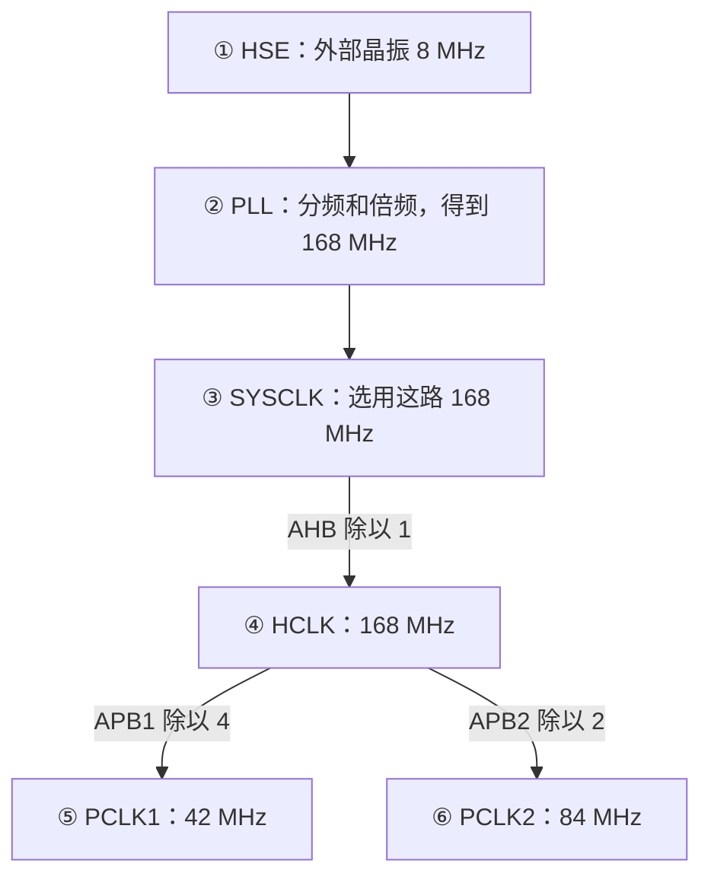

# 嵌入式系统：第 1–4 章知识梳理与复习重点

整理日期：2026-09-30。依据本地 4 份教师版课件（共 186 页）、两次作业及芯片手册。课件页码按幻灯片顺序计数。

**本文件是完整课件的备查提纲。** 按本次确认的课堂进度，先看 [课堂入门：开发板与读图](./class-introduction_board-and-schematic-reading.md)，弄清 F407、潘多拉开发板和图中各部分；建工程、GPIO 编程等属于后续参考。下面的优先级覆盖完整资料，不代表本节课已经全部讲完。

**读图起点：** 如果时钟树看不懂，先看第五部分的“第一次读时钟树”。先认清节拍的来源、变频和分配，再看 PLL 公式。

文中的芯片参数默认针对 **STM32F407ZGT6**。第 4 章同时讲到 STM32 和 GD32，部分图还混入其他型号特性，不能把所有参数套到 F407 上。文末列出了原课件、旧笔记与作业解答中需要区分或更正的内容。

## 一、复习顺序与达标要求

| 优先级 | 内容 | 复习完应能独立完成 | 课件定位 |
|---|---|---|---|
| 先掌握 | 时钟源、PLL、SYSCLK、HCLK、PCLK | 算出 168/42/84 MHz，解释定时器倍频，说明切换时钟的步骤 | 第 4 章第 15–17、41、43 页 |
| 先掌握 | 存储器映射、内核与片上外设、总线 | 画出地址分区，判断 GPIO、TIM2、USART1、SysTick 的位置 | 第 3 章第 18–22 页；第 4 章第 9–14 页 |
| 先掌握 | 堆栈、中断、向量表、复位 | 画出中断处理过程，解释启动文件如何进入 main | 第 3 章第 29–40、71–73 页 |
| 先掌握 | 进制、补码、ASCII、小端、位运算 | 独立重做第一次作业第 1–3 题 | 第 2 章第 13–35 页 |
| 随后掌握 | 系统组成、最小系统、工程结构 | 画结构图，指出硬件各部分作用，解释工程主要文件 | 第 1 章第 4–10 页；第 4 章第 18–34、42 页 |
| 随后掌握 | 寄存器、运行模式、位带、CMSIS、嵌入式 C | 能解释概念、读懂简单代码 | 第 3 章第 23–34、41–64 页；第 4 章第 35–40 页 |
| 最后补充 | 发展史、厂商与封装、指令分类 | 用自己的话概述，按题目查具体型号 | 第 1 章第 8 页；第 3 章第 9–13、41–58、65–69 页 |

课程主线：**应用需求决定系统组成；计算机基础解释数据如何存储和运算；Cortex-M4 解释程序如何执行；STM32 应用基础把内核、外设、时钟和工程连接起来。**

## 二、第 1 章：嵌入式系统是什么

### 1. 概念与组成

嵌入式系统面向特定应用，把计算、控制和通信功能嵌入设备中，并按需求配置软硬件。答概念题时，围绕“做什么、用什么硬件、运行什么软件、受哪些约束”展开。

| 概念 | 理解要点 |
|---|---|
| CPU | 执行指令并控制数据处理的核心 |
| MCU | 将处理器、存储器和多种外设集成在同一芯片上的微控制器 |
| MPU | 在处理器分类中常指微处理器；在 Cortex-M4 内核中也可指 Memory Protection Unit，需看上下文 |
| DSP | 面向数字信号处理的处理器或相关运算能力 |
| SoC | 将系统所需的多种功能集成在一颗芯片上 |
| ECU | 车辆或装备中的电子控制单元，包含控制器及其配套电路、软件 |
| Cortex-M4 / STM32F407 | 前者是处理器内核，后者是采用该内核的一款 MCU |

**结构图答题框架：** 输入端写传感器与信号调理，中央写 MCU、存储器和软件，输出端写驱动电路与执行器，再补充电源、人机交互及通信接口。涉及闭环控制时，画出被控对象经传感器反馈到控制器的路径。

例如自动灌溉系统可以用“湿度传感器采集、MCU 判断、驱动阀门、水量改变、再次采集”说明各部分关系。举应用例子时，每个方框都应能说明具体作用。

### 2. 软件与开发方式

- **轮询系统：** 主循环依次检查并处理任务。
- **前后台系统：** 中断处理需要及时响应的事件，主循环执行其他任务。
- **多任务系统：** 由操作系统调度不同任务。
- **交叉开发：** 在 PC 上编辑、编译程序，再下载到目标板运行和调试。

达标练习：闭卷画出一个农业装备控制系统，标明输入、处理、输出、反馈和供电；解释为什么只写一颗 MCU 还不足以描述完整应用系统。

来源：[第 1 章课件](../01_课件/01--概述V2.1（教师版）.pptx)，第 4–10、13 页。

## 三、第 2 章：数据怎样表示、存储和运算

### 1. 计算机工作原理

硬件的基本组成是运算器、控制器、存储器、输入设备和输出设备。程序先存入存储器，CPU 按程序流程反复取指、译码和执行。

| 总线 | 回答的问题 | 例子 |
|---|---|---|
| 地址总线 AB | 访问哪里 | 给出存储单元地址 |
| 数据总线 DB | 传什么内容 | 传递指令或数据 |
| 控制总线 CB | 做什么、何时做 | 发出读写控制信号 |

区分 **寻址空间** 与 **实际容量**：32 位字节地址能表示 4 GB 地址空间，具体芯片实际装有多少 Flash、SRAM，要看型号。

### 2. 数制与编码速记

| 内容 | 规则或例子 |
|---|---|
| 十六进制转二进制 | 每个十六进制位对应 4 个二进制位；0x45 = 0100 0101 |
| n 位无符号整数 | 0 到 2ⁿ−1 |
| n 位补码整数 | −2ⁿ⁻¹ 到 2ⁿ⁻¹−1；8 位为 −128 到 127 |
| 补码 | 正数与原二进制表示相同；求负数表示时，在固定字长内对其绝对值取反加 1 |
| ASCII 数字字符 | '0' 到 '9' 对应 0x30 到 0x39；字符 '5' 为 0x35 |
| 8421 BCD | 用 4 位表示一个十进制数字；十进制 59 的压缩 BCD 为 0x59，普通二进制整数 59 为 0x3B |
| 字节与字 | 1 字节 = 8 bit；本课程 Cortex-M4 的字为 32 bit，半字为 16 bit |

同一组位的含义取决于解释方法。例如 `1000 0000` 作为 8 位无符号数是 128，作为 8 位补码整数是 −128。

字符串题逐个编码字符，不把整串学号当作一个整数转换。若题目要求 C 字符串，通常还需结尾的 `0x00`；若只要求显示字符的字节编码，应区分字符内容与终止符。

### 3. 小端存储必会画

将 `0x45671234` 存入从地址 A 开始的 4 个字节，按地址递增排列：

| 地址 | 字节内容 | 二进制 |
|---|---|---|
| A | 0x34 | 0011 0100 |
| A+1 | 0x12 | 0001 0010 |
| A+2 | 0x67 | 0110 0111 |
| A+3 | 0x45 | 0100 0101 |

记忆：**低有效字节放低地址。** 字节内部各 bit 的顺序照常书写。单字节 `0x45` 只占一个单元，无需调整字节顺序。

### 4. 运算题与位操作

| 原作业算式 | 结果 | 检查点 |
|---|---|---|
| 0xB9 + 0x6A | 0x123 | 若限定 8 位，只保留 0x23，同时产生向第 9 位的进位 |
| 0xB9 − 0x6A | 0x4F | 二进制减法逐位借位 |
| 0x6789BCDF & 0xF0000000 | 0x60000000 | 按位与，用掩码保留高 4 位 |
| 0x56347819 \| 0x0A0AFFFF | 0x5E3EFFFF | 按位或，两个对应位有一个为 1，结果就为 1 |

进位与有符号溢出分别判断。8 位补码下，`0xB9 + 0x6A` 是 −71 + 106 = 35，虽有进位，但没有有符号溢出；`0x7F + 1` 则发生有符号溢出。

对普通 32 位无符号变量 `x`，操作第 n 位可写为：

```c
x |=  (1u << n);        // 置 1
x &= ~(1u << n);        // 清 0
x ^=  (1u << n);        // 翻转
bit = (x >> n) & 1u;    // 取出该位
```

这里 n 应在 0–31 内。操作硬件寄存器时，还要看手册规定的读写方式，例如有些状态位通过“写 1”清除。

### 5. 其他要点

Flash 常用于保存掉电后仍需保留的程序；SRAM 常用于运行中的变量、堆栈。画流程图时明确开始、初始化、条件分支、处理动作和循环返回，条件判断应标出不同分支。

来源：[第 2 章课件](../01_课件/02--计算机基础知识2.1（教师版）.pptx)，第 5–12、13–35、36–40、49–53 页；[第一次作业题目](../02_作业_2026-09-19/嵌入式作业_2026-09-19.md)。

## 四、第 3 章：Cortex-M4 如何执行程序

### 1. 内核、寄存器与运行模式

Cortex-M4 使用 ARMv7E-M 架构。把内核功能与芯片外设分开记：NVIC、SysTick 等属于内核侧组件；GPIO、USART、CAN 等是芯片厂商集成的外设。

| 名称 | 作用 |
|---|---|
| R0–R12 | 通用寄存器 |
| R13 / SP | 堆栈指针，实际使用 MSP 或 PSP |
| R14 / LR | 链接寄存器，普通函数调用时用于保存返回信息 |
| R15 / PC | 程序计数器，与当前指令执行位置有关 |
| xPSR | 程序状态信息 |
| CONTROL | 与线程模式的权限、堆栈选择等有关 |
| NVIC | 管理中断使能、挂起及优先级等 |
| MPU | 管理存储区域访问权限 |
| FPU | 浮点运算单元；STM32F407 的 FPU 支持单精度 |

**线程模式**执行普通程序，可为特权或非特权；**处理模式**执行异常处理程序，始终为特权并使用 MSP。线程模式可以选择 MSP 或 PSP。模式、权限和堆栈选择是不同概念。

堆栈按后进先出工作。Cortex-M4 使用向低地址增长的满递减栈，SP 指向当前栈顶。读 PUSH/POP 图时同时标出地址方向和 SP 变化。

### 2. 存储器映射

按功能合并后记住以下 6 段，总容量为 4 GB。外部 RAM 和外部设备各占 1 GB，因此不要把下面每一行都当成 512 MB。

| 地址范围 | 大小 | 区域 |
|---|---|---|
| 0x00000000–0x1FFFFFFF | 512 MB | Code |
| 0x20000000–0x3FFFFFFF | 512 MB | SRAM |
| 0x40000000–0x5FFFFFFF | 512 MB | Peripheral，片上外设 |
| 0x60000000–0x9FFFFFFF | 1 GB | External RAM |
| 0xA0000000–0xDFFFFFFF | 1 GB | External Device |
| 0xE0000000–0xFFFFFFFF | 512 MB | System，包含内核私有外设及其他系统区域 |

这是架构定义的地址分区，具体芯片只实现其中一部分。STM32F407 主 Flash 从 `0x08000000` 开始，主 SRAM 从 `0x20000000` 开始；复位时地址 0 附近映射到哪个启动存储器，由启动配置决定。

寄存器地址的读法：**具体寄存器地址 = 外设基地址 + 寄存器偏移量。** 例如 GPIOA 基地址为 `0x40020000`。R0–R15 这类 CPU 寄存器与通过地址访问的外设寄存器要分开理解。

### 3. 位带与 SysTick

位带把目标区域中的一个 bit 映射为别名区中的一个 32 位访问地址。计算式为：

```text
别名地址 = 别名区基址 + 字节偏移 × 32 + 位号 × 4
SRAM 位带区：0x20000000–0x200FFFFF；别名区从 0x22000000 开始
外设位带区：0x40000000–0x400FFFFF；别名区从 0x42000000 开始
```

例：`0x20000010` 的 bit 3 对应 `0x22000000 + 0x10×32 + 3×4 = 0x2200020C`。先确认地址落在支持位带的范围内。

SysTick 是 **24 位递减计数器**，常用于系统节拍。在 STM32F407 上可选择 HCLK 或 HCLK/8 作为输入。连续周期计数时：

```text
周期 T = (LOAD + 1) / fSysTick
LOAD = T × fSysTick − 1，且 LOAD 不超过 0xFFFFFF
```

例如输入 168 MHz，要得到 1 ms 周期，`LOAD = 167999`。换成 HCLK/8 = 21 MHz 时，`LOAD = 20999`。

### 4. 中断与向量表

按以下顺序讲清一次中断：事件产生请求；控制器结合使能、屏蔽和优先级判断能否响应；硬件保存现场并取得服务程序入口；执行服务程序；异常返回时恢复现场，继续原程序。保存现场和取向量在硬件中可并行进行。

基础硬件入栈内容为 R0–R3、R12、LR、PC、xPSR。涉及浮点上下文时还可能有额外保存。中断服务程序应按外设规则处理或清除中断源，避免退出后立即再次进入。

| 向量表偏移 | 内容 |
|---|---|
| 0x00 | 初始 MSP 值 |
| 0x04 | Reset_Handler 入口 |
| 0x08 起 | NMI、HardFault 等异常向量及保留项 |
| 0x3C | SysTick 入口 |
| 0x40 + 4n | 外部中断 IRQn 的入口 |

表中偏移要加向量表基地址。优先级数值越小通常表示可配置优先级越高；**抢占优先级**决定是否能打断当前处理，**子优先级**用于同一抢占优先级的待处理中断排序。

### 5. 从复位到 main

结合本地启动参考文件理解：

```text
复位后读取初始 MSP 和复位向量
    ↓
Reset_Handler
    ↓
SystemInit
    ↓
__main（C 运行库初始化，例如初始化数据段、清零未初始化数据）
    ↓
用户 main()
```

`SystemInit` 做哪些配置取决于所用库和工程。标准库示例与 CubeMX/HAL 工程的系统时钟配置位置可能不同，HAL 工程通常在 main 中调用 `SystemClock_Config()`。

CMSIS 提供统一的内核访问接口及相关约定，理解工程时重点认出内核头文件、器件头文件、启动文件和系统初始化文件。汇编先能辨认 MOV、LDR/STR、ADD/SUB、B/BL/BX、PUSH/POP，再扩展指令分类。

来源：[第 3 章课件](../01_课件/03--Cortex-M4内核体系结构-V2.1（教师版）.pptx)，第 13–40、41–64、71–73 页；[启动参考文件](../03_作业_2026-09-29/startup_stm32f40_41xxx_参考.s)。

## 五、第 4 章：STM32 芯片与工程基础

### 1. 关键参数与最小系统

STM32F407ZGT6：Cortex-M4 内核，带单精度 FPU，最高 168 MHz；1 MB Flash；192 KB SRAM，包括 112 KB SRAM1、16 KB SRAM2 和 64 KB CCM，另有 4 KB 备份 SRAM；LQFP144 封装。常用板级供电为 3.3 V，器件正常应用供电范围按数据手册为 1.8–3.6 V。

最小系统围绕五部分识图：

| 部分 | 需要解释的作用 |
|---|---|
| 电源 | 给数字、模拟及内核相关电路提供符合要求的电源，并做好去耦 |
| 时钟 | 提供运行节拍；按设计使用片内 RC 或外部时钟器件 |
| 复位 | 使芯片进入确定的初始状态，NRST 低电平有效 |
| 启动配置 | 选择主 Flash、系统存储器或 SRAM 等启动来源 |
| 下载与调试 | 通过 SWD/JTAG 等接口烧录、调试程序 |

GPIO 能否容忍 5 V 要查具体引脚和使用条件，不能据此给 VDD 接 5 V。

来源：[第 4 章课件](../01_课件/04--STM32芯片应用基础-V2.1（教师版）.pptx)，第 6–8、18–27 页；参数核对见 [F407 数据手册](../03_作业_2026-09-29/STM32F407ZGT6数据手册_ST.pdf)，第 1、14–16、121 页。

### 2. 总线与外设对应

| 外设或模块 | 所属总线/区域 | 基地址或定位 | 复习重点 |
|---|---|---|---|
| GPIOA | AHB1 | 0x40020000 | 使用前使能 AHB1 上对应 GPIO 时钟 |
| RCC | AHB1 | 0x40023800 | 管理时钟、复位与外设时钟使能 |
| TIM2 | APB1 | 0x40000000 | 分清 PCLK1 与定时器实际输入时钟 |
| CAN1 / CAN2 | APB1 | 0x40006400 / 0x40006800 | 位于片上外设地址区 |
| USART1 | APB2 | 0x40011000 | 其时钟来源与 USART2 不同 |
| SysTick | 内核私有外设 / SCS | 0xE000E010 | 与 TIM2 的位置和时钟选择不同 |

总线矩阵连接发起访问的主端与响应访问的从端。F407 的 **8 主 7 从**可这样记：

- 主端：内核 I/D/S 三路、DMA1 存储器一路、DMA2 存储器与外设两路、以太网 DMA 一路、USB OTG HS DMA 一路。
- 从端：Flash 指令/数据两路、SRAM1、SRAM2、AHB1 外设及 APB 桥、AHB2 外设、FSMC。

64 KB CCM 不在这套总线矩阵中，只能由 CPU 访问，不能当作 DMA 缓冲区使用。

来源：第 4 章第 9–14 页；F407 数据手册第 73–76 页；[ST RM0090 参考手册](https://www.st.com/resource/en/reference_manual/dm00031020-stm32f405415-stm32f407417-stm32f427437-and-stm32f429439-advanced-armbased-32bit-mcus-stmicroelectronics.pdf)，Rev 22 第 2.1 节。

### 3. 时钟体系：本阶段重点

#### 第一次读时钟树

时钟可以理解为芯片内部工作的**节拍信号**。8 MHz 表示每秒有 800 万个周期，168 MHz 表示每秒有 1.68 亿个周期。一个时钟周期不一定完成一条指令。

先沿课件图中的这条路径看：**HSE → PLL → SYSCLK → AHB 分频 → HCLK → APB1/APB2 分频**。

1. **HSE：节拍从哪里来。** 本例由板上 8 MHz 外部晶振提供原始节拍。
2. **PLL：把节拍频率调到需要的值。** 通过分频和倍频，本例把 8 MHz 变成 168 MHz。第一遍读图先把 PLL 当成一个调频方框。
3. **SYSCLK：系统选中了哪一路时钟。** 图中有 HSI、HSE、PLL 三路候选。本例选择 PLL 的 168 MHz；三路候选不相加。
4. **HCLK：经过 AHB 分频后的时钟。** 本例除以 1，所以仍是 168 MHz。SYSCLK 和 HCLK 名字不同，是因为它们位于分频器前后；换成除以 2，HCLK 就变为 84 MHz。
5. **PCLK1、PCLK2：继续分给两组外设的时钟。** 在 HCLK=168 MHz 时，APB1 除以 4 得到 42 MHz，APB2 除以 2 得到 84 MHz。不同外设允许的频率不同，所以要分开供给。

读图时，箭头表示时钟信号的传递路径；“÷4”表示频率变为原来的四分之一；多条输入接到一个选择器时，表示从中选一路；“使能”像开关，决定是否向对应模块提供时钟。对本章的 F407，先掌握主路径，再补 RTC、USB、I²S 等分支。

**检查是否看懂：** 已知 HCLK 是 168 MHz，在某条分支看到“÷4”，应立即能算出该分支为 42 MHz，并能沿箭头找到它送给谁。

**先区分振荡源、PLL 和分配后的时钟。** 对 STM32F407，四个常见振荡源如下：

| 时钟源 | 来源与频率 | 主要作用 |
|---|---|---|
| HSI | 片内 RC，16 MHz | 复位后的系统时钟来源，也可送入主 PLL |
| HSE | 外部晶振/谐振器，4–26 MHz；具体板子频率按原理图 | 系统时钟或 PLL 输入 |
| LSI | 片内低速 RC，约 32 kHz | 独立看门狗，亦可供 RTC 选择 |
| LSE | 外部低速晶振，32.768 kHz | RTC 时钟 |

F407 有主 PLL 与 PLLI2S 两个 PLL。**SYSCLK 从 HSI、HSE、主 PLL 输出中选择一路。** 主 PLL 的 P 分频输出可供 SYSCLK，Q 分频输出可供 USB OTG FS、SDIO、RNG。

#### 典型计算：8 MHz 外部晶振配置到 168 MHz

```text
PLL 输入分频：8 MHz / M(8) = 1 MHz
VCO 倍频：    1 MHz × N(336) = 336 MHz
PLL P 输出：  336 MHz / P(2) = 168 MHz，选择它作为 SYSCLK
PLL Q 输出：  336 MHz / Q(7) = 48 MHz

HCLK  = SYSCLK / AHB 分频数  = 168 / 1 = 168 MHz
PCLK1 = HCLK   / APB1 分频数 = 168 / 4 = 42 MHz
PCLK2 = HCLK   / APB2 分频数 = 168 / 2 = 84 MHz
```

下面将这组配置简化为 6 个位置。APB 时钟由 **HCLK 再分频**得到，计算时不要跳过 AHB 分频。定时器倍频在图后的表格中单独说明。



| 项目 | STM32F407 的要点 |
|---|---|
| 频率上限 | SYSCLK/HCLK 168 MHz；PCLK1 42 MHz；PCLK2 84 MHz |
| APB 定时器 | APB 分频数为 1 时，TIM 时钟等于 PCLK；分频数大于 1 时，等于 2×PCLK |
| GPIO | 总线时钟来自 AHB1，168 MHz 总线频率不等于引脚能以 168 MHz 翻转 |
| SysTick | 可选 HCLK 或 HCLK/8，结合 LOAD 算周期 |
| ADC | 时钟由 PCLK2 进一步分频，不能直接等同于 PCLK2 |

该定时器规则针对本节的 F407；换其他 STM32 型号时重新查其时钟树。

#### 设置时钟的理解顺序

1. 确认具体芯片、板上 HSE 频率和目标主频。
2. 先算 PLL 以及 AHB/APB 各级频率，核对允许范围。
3. 准备符合目标频率的电压档位、Flash 等待周期和总线分频设置。
4. 启动所需振荡源并等待就绪；修改 PLL 参数前，确保它已停用且没有被用作当前系统时钟。
5. 配置并启动 PLL，等待锁定就绪。
6. 选择系统时钟来源，并读取 SWS 确认实际切换成功。
7. 更新软件记录的时钟频率及受影响的 SysTick/延时设置，再使用需要的外设。

对应寄存器重点看 `RCC_CR`、`RCC_PLLCFGR`、`RCC_CFGR`，以及各外设时钟使能寄存器。写了切换控制位之后，还要检查硬件状态；升高主频之前，要先满足 Flash 和供电条件。

来源：第 4 章第 15–17、41、43 页；[ST RM0090](https://www.st.com/resource/en/reference_manual/dm00031020-stm32f405415-stm32f407417-stm32f427437-and-stm32f429439-advanced-armbased-32bit-mcus-stmicroelectronics.pdf)，Rev 22 第 7.2 节，适用 STM32F405/407、415/417；F407 数据手册第 1、106–108 页。课件中的跨型号参数已按 F407 手册区分。

### 4. 工程与三种编程方法（后续参考）

| 方法/文件 | 需要掌握的内容 |
|---|---|
| 寄存器法 | 根据手册理解地址和位字段，直接配置硬件 |
| 标准外设库 STD | 用库函数及结构体完成外设配置，能够回到寄存器层解释作用 |
| HAL | 用 HAL 接口组织初始化及操作，CubeMX 可生成配套工程 |
| startup…s | 初始堆栈、向量表、复位入口 |
| system_stm32f4xx.c | 系统初始化及相关时钟支持，具体行为看工程版本 |
| main.c | 应用初始化与主循环 |
| stm32f4xx_it.c | 异常、中断服务相关函数 |
| 头文件与库文件 | 器件定义、接口声明和具体驱动实现 |

理解 GPIO 初始化的共同顺序：使能端口时钟，配置引脚模式等参数，再读写引脚。进一步画出“按键输入判断、LED 输出、延时或定时、返回主循环”的程序流程。第 5 章尚无本地课件，本提纲只整理这一前置流程。

来源：第 4 章第 28–42 页。配套视频：[STD 建工程](../04_讲课视频/演示STDLIB标准库新建工程.wmv)、[CubeMX 建工程](../04_讲课视频/演示STM32CubeMX新建工程.wmv)、[汇编演示](../04_讲课视频/演示STM32汇编语言.wmv)。

## 六、两次作业如何对应复习

| 作业 | 题号 | 对应复习内容 |
|---|---|---|
| 2026-09-19 | 1–3 | 二进制表示、小端、ASCII、算术与位运算 |
| 2026-09-19 | 4–6 | 系统概念、农业应用案例、两类结构图 |
| 2026-09-19 | 7 | 缩写的全称和作用，结合系统组件记忆 |
| 2026-09-29 | 1 | 内核、总线与外设缩写 |
| 2026-09-29 | 2–4 | 存储器映射、中断与向量表、外设总线归属 |
| 2026-09-29 | 5 | 时钟源、PLL、系统和总线频率 |
| 2026-09-29 | 6–7 | 复位电路、按完整型号阅读芯片手册 |
| 2026-09-29 | 8 | 原理图、工程模板、启动文件、GPIO 操作 |

查找原题与解答：[第一次作业目录](../02_作业_2026-09-19/)、[第二次作业解答](../03_作业_2026-09-29/嵌入式作业_2026-09-29_解答.md)。第二次作业解答存在下表所列问题，复习时请结合更正阅读。

## 七、旧资料中需要区分和更正的地方

| 位置/原说法 | 正确理解 | 核对依据 |
|---|---|---|
| 第二次作业把“潘多拉 IoT 板主控”写成 STM32L496 | 常见正点原子潘多拉 IoT 板主控为 STM32L475VET6。L496 是另一款芯片，下列 L496 参数核对也不能直接用作潘多拉板的描述 | [RT-Thread 官方板级说明](https://raw.githubusercontent.com/RT-Thread/rt-thread/master/bsp/stm32/stm32l475-atk-pandora/README.md) |
| 综合分析将“5 个源、3 个 PLL、IRC48M、PLLSAI”套用于当前 F407；第二次作业称另有独立 USB/SDIO PLL | STM32F407 为 HSI/HSE/LSI/LSE 四个振荡源、主 PLL 和 PLLI2S 两个 PLL；48 MHz 可由主 PLL 的 Q 分频得到。不能直接套用其他型号时钟树 | RM0090 Rev 22 第 7.2.3 节；F407 手册第 106–108 页 |
| 课件第 16 页及综合分析使用 MCO0/1 | F407 手册命名为 MCO1、MCO2，分别对应 PA8、PC9 | RM0090 第 7.2.10 节 |
| 第二次作业第 2 题图中把 GPIOA 写在 APB2 | F407 的 GPIOA 在 AHB1；原文后面的表格已写 AHB1，两处不一致 | F407 手册第 75 页 |
| 第二次作业第 2 题分区编号与地址边界不一致 | 按本提纲的地址范围学习；外部 RAM 和外部 Device 各为 1 GB | 第 3 章第 19–22 页 |
| 课件第 7、9、19 页出现 F407 典型供电 4.3 V、上限 4.6 V | F407 正常应用供电范围为 1.8–3.6 V，常见开发板为 3.3 V | F407 手册第 1、14–16 页 |
| 第二次作业将 NRST 的“20 μs”当作外部输入复位脉宽阈值 | 手册表 51 的 20 μs 对应内部复位源产生的输出脉冲持续时间；外部 NRST 要按输入电平和滤波参数判断 | F407 手册第 121 页，表 51 |
| 第二次作业把 L496 写成原生“16 位 ADC、5.33 Msps” | L496 为 12 位 ADC，最高 5 Msps，硬件过采样可得到最高 16 位结果；两种指标应分别写清 | L496 手册第 2、42 页 |
| 第二次作业写 L496 另有“16 KB 备份 SRAM、AES” | L496 数据手册列出总计 320 KB SRAM（含 64 KB SRAM2）及 32×32 bit 备份寄存器；所列加速器为 HASH，不能直接加上这两项特性 | L496 手册第 1、20、52 页 |
| 第二次作业称向量表“81 个外设项，IRQ0–80，FPU 最后一项，共 98 项” | 本地 F40/41 共用启动文件实际为 16+82=98 个 DCD 表项，FPU 在 IRQ81。表项槽位数也不等于某一型号实际拥有的外设数量 | 本地 startup_stm32f40_41xxx_参考.s 逐项计数 |
| 第二次作业把 CCM 与 SRAM1/2 一起列入总线矩阵从端 | CCM 只能由 CPU 访问，不属于这套总线矩阵，不能供 DMA 直接访问 | RM0090 第 2.1 节 |

芯片参数原文：[ST F407 数据手册](https://www.st.com/resource/en/datasheet/stm32f407zg.pdf)、[ST L496 数据手册](https://www.st.com/resource/en/datasheet/stm32l496ag.pdf)。本地版本分别为 DS8626 Rev 12、DS11585 Rev 20。关于 L496 的结论只针对该系列，具体 Flash 容量等仍需核对完整料号。

## 八、90 分钟复习安排与闭卷自测

### 建议安排

| 时间 | 任务 | 留下的结果 |
|---|---|---|
| 0–15 分钟 | 重做第一次作业第 1–3 题 | 一张小端表、字符编码和四道运算 |
| 15–35 分钟 | 默画存储器分区、中断过程和复位流程 | 三张简图，标明地址与向量表首两项 |
| 35–60 分钟 | 手算 PLL、各总线和定时器时钟 | 一张带数值的时钟树，解释分频关系 |
| 60–75 分钟 | 识别最小系统与工程文件 | 五部分硬件作用、主要源文件作用 |
| 75–90 分钟 | 完成下列自测并对照纠错表 | 标出不会的题，只回看对应课件页 |

### 自测题

1. 画一个农业装备嵌入式系统，指出传感器、控制器、执行器和反馈路径。
2. 8 位无符号数与补码整数分别能表示什么范围？
3. `0x45671234` 在小端机器中，从低地址到高地址依次存什么？
4. 字符 '5' 的 ASCII、数字 5 的 8421 BCD、普通整数 5 的编码分别是什么？
5. `0xB9 + 0x6A` 若只保留 8 位，结果、进位和有符号溢出分别如何？
6. 片上外设区域、SRAM 区域、System 区域分别从什么地址开始？
7. GPIOA、TIM2、USART1、SysTick 分别属于哪个总线或区域？
8. 向量表首两项是什么？IRQ5 对应的表项偏移是多少？
9. Handler 模式具有什么权限，使用哪个堆栈？
10. 复位后从 Reset_Handler 到 main，要经过哪些关键步骤？
11. HSE=8 MHz、M=8、N=336、P=2、Q=7，PLL 两路输出是多少？
12. 上述 SYSCLK 下，AHB÷2、APB1÷2、APB2÷1，HCLK、PCLK1、PCLK2、TIM2 时钟分别是多少？
13. SysTick 选择 168 MHz 时钟，要产生 1 ms 周期，LOAD 填多少？
14. 为什么 F407 的“168 MHz AHB”不能直接写成“GPIO 每秒翻转 1.68 亿次”？
15. 修改 PLL 或升高系统时钟前，要先检查哪些条件？
16. L496 的“12 位 ADC”和“过采样至 16 位”分别指什么？

### 答案要点

1. 输入采集、信号调理、MCU 处理、驱动执行和反馈完整，补充供电及所需通信/交互。
2. 0–255；−128–127。
3. `34 12 67 45`（十六进制）。
4. `0x35`、`0101`（放入一字节可写 `0x05`）、整数 5 若以一字节表示为 `0x05`；后两者在单个小数字上可能相同，编码规则不同。
5. 低 8 位 `0x23`；有向第 9 位的进位；无有符号溢出。
6. Peripheral：`0x40000000`；SRAM：`0x20000000`；System：`0xE0000000`。
7. AHB1、APB1、APB2、内核私有外设/SCS。
8. 初始 MSP 与 Reset_Handler 入口；`0x40 + 5×4 = 0x54`。
9. 特权执行，使用 MSP。
10. 本地参考文件先调用 SystemInit，再进入 C 运行库 __main 完成运行环境初始化，最后到用户 main。
11. P 路 168 MHz，Q 路 48 MHz。
12. 84、42、84、84 MHz。APB 分频从 HCLK 继续计算。
13. `168000 − 1 = 167999`。
14. 总线时钟与引脚输出翻转能力是不同指标，后者还受读写过程、电气负载和 I/O 规格等影响。
15. 芯片及 HSE 型号参数、各级频率上限、供电/电压档位、Flash 等待周期、PLL 是否停用、就绪标志及实际切换状态。
16. ADC 原始转换分辨率为 12 位，通过硬件过采样处理可获得最高 16 位结果。

完成自测后，优先回看答错题对应的概念和课件页，再换一组数字重算时钟、小端和位运算。
