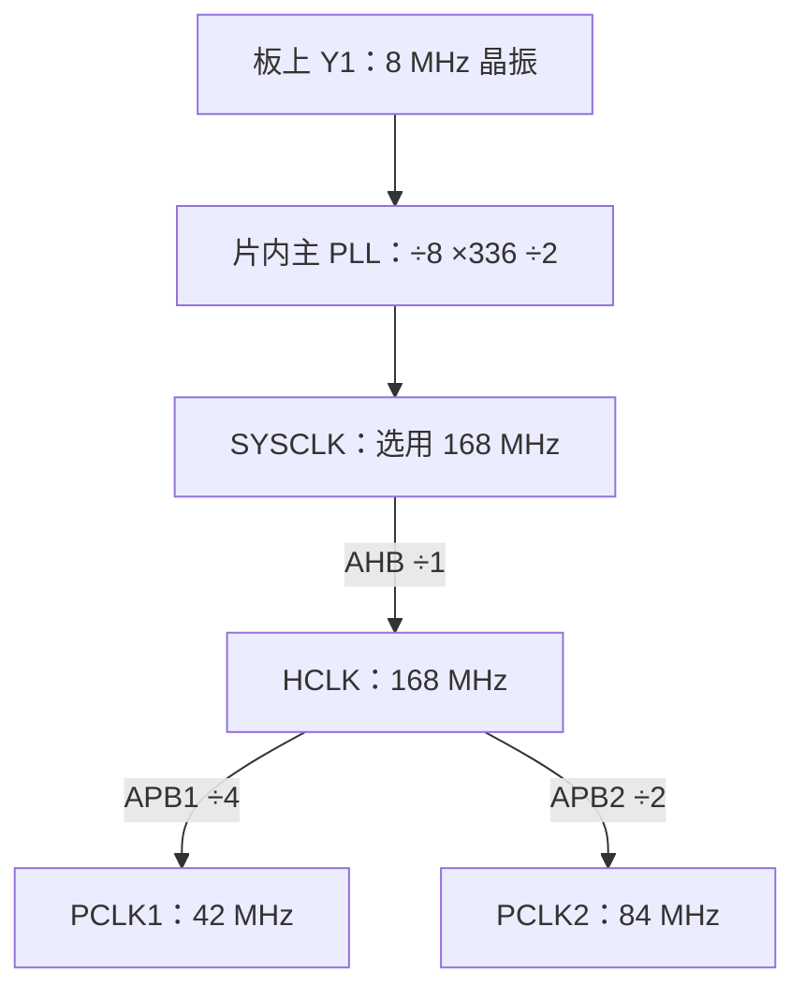

# STM32F407ZGT6 硬件平台架构与原理图电气分析指南

本文以本地保存的普中 F407-T100 商用原型验证开发板原理图（图纸日期 2020-12-24，主控 U1 标注为 STM32F407ZGT6）为分析对象，按板卡概况、读图方法、电源、复位、时钟、启动与调试、GPIO 外设引脚拓扑的顺序整理各部分电气事实，并与 ST 官方手册逐项核对。文中关于 LED、按键与接口的接线结论仅针对该原理图；其余 F407 开发板的引脚分配由各自板卡设计决定。

开发板将 MCU 与其运行所需的配套电路完成互连，为整板供电、程序下载，以及通过指示灯、按键和通信接口观察程序行为提供硬件条件。

## 1. 开发板概况与资料定位

### 1.1 开发板、芯片与内核的三层结构

```text
F407 开发板：整块电路板
  ├─ U1：STM32F407ZGT6 主控芯片
  │    ├─ Cortex-M4 内核：执行程序指令
  │    ├─ 片内 Flash：保存程序和需要保留的数据
  │    ├─ 片内 SRAM：保存运行时变量、缓冲区、堆栈
  │    ├─ GPIO、TIM、USART、SPI、I²C、ADC 等外设模块
  │    └─ RCC、总线等配套模块
  └─ 芯片之外：稳压器、晶振、复位按钮、LED、接口、扩展存储器等
```

- **板层：** 整块电路板，含稳压器、晶振、复位按钮、LED、按键、接口、扩展存储器等芯片之外的器件；板上还可有下载调试芯片、存储芯片或无线模块。主控识别依据元件位号、型号标注与原理图。
- **芯片层：** U1 即 STM32F407ZGT6，内部已集成 CPU、存储器与各类片上外设。原理图中间标注"CPU"的黄色矩形符号画的是整颗 STM32F407ZGT6 的引脚符号。
- **内核层：** Cortex-M4，执行指令的处理核心。

课堂称谓"F407 开发板"指采用 STM32F407 的一类开发板，具体接口配置取决于板型；"潘多拉"是开发板产品名，此处按常见的正点原子潘多拉 IoT 板理解，主控为 STM32L475VET6。两板同属 Cortex-M4 内核（带 FPU），主控芯片与板载资源各异。STM32L496 属于另一款芯片，其手册对应器件与潘多拉板无关，潘多拉的技术描述以 L475VET6 的资料为准。

| 课堂中的称呼 | 板卡性质 | 主控芯片 | 内核 | 最高主频 |
|---|---|---|---|---|
| F407 开发板 | 采用 STM32F407 的一类开发板，有不同厂商和版本 | 本地资料对应 STM32F407ZGT6 | Cortex-M4，带单精度 FPU | 168 MHz |
| 潘多拉开发板 | 正点原子潘多拉 IoT 板 | STM32L475VET6 | Cortex-M4，带 FPU | 80 MHz |

F407 时钟参数为该平台自身的一组典型配置；潘多拉所用 L475VET6 的节拍参数由其自身架构与手册决定，两平台的参数不可相互代入。

核对来源：[本地 F407 数据手册](../03_作业_2026-09-29/STM32F407ZGT6数据手册_ST.pdf)；[RT-Thread 官方潘多拉板说明](https://raw.githubusercontent.com/RT-Thread/rt-thread/master/bsp/stm32/stm32l475-atk-pandora/README.md)；[ST 的 L475VE 产品页](https://www.st.com/en/microcontrollers-microprocessors/stm32l475ve.html)。

### 1.2 型号 STM32F407ZGT6 的字段含义

| 字段 | 本型号中的含义 |
|---|---|
| STM32 | ST 的 Arm 32 位微控制器系列 |
| F407 | 器件子系列，F4 家族中的 F407 |
| Z | 144 个封装引脚 |
| G | 1024 KB，即 1 MB 片内 Flash |
| T | LQFP 封装，四边引出引脚的方形扁平封装 |
| 6 | 工业温度等级，−40～85 ℃ |

关键规格的确定性表述：

- **32 位：** 内核通用寄存器和主要运算的数据宽度为 32 位，兼容字节、半字数据处理。
- **最高 168 MHz：** 芯片允许配置到的最高主频；复位后芯片默认运行于片内 HSI 16 MHz，168 MHz 由软件配置 PLL 后切换达成。
- **1 MB Flash：** 下载进去的程序通常保存在这里，断电后内容保留。
- **192 KB SRAM：** 包含 112 KB SRAM1、16 KB SRAM2、64 KB CCM 数据 RAM，另有 4 KB 备份 SRAM。SRAM1/SRAM2 与 CCM 的内容保持以持续供电为前提；备份 SRAM 的掉电保持由 VBAT 支撑。
- **144 脚：** 包含供电、地、复位、启动和时钟等引脚；LQFP144 型号的 GPIO 数量为 114，其余引脚承担上述系统功能。

64 KB CCM 经 CPU 专用访问通路连接，DMA 控制器的传输目标应安排在 SRAM1/SRAM2，见 RM0090 第 2.1 节。

来源：DS8626 第 16、22、186 页。

### 1.3 官方手册与开发板原理图的分工

| 资料 | 回答的问题 | 本文引用位置 |
|---|---|---|
| [本地开发板原理图](../03_作业_2026-09-29/普中F407-T100开发板原理图_STM32F407ZGT6.pdf) | 板上装了哪些器件？哪根脚接哪盏灯？晶振是多少？ | 单页，按红色分区读 |
| [DS8626：F407 数据手册](../03_作业_2026-09-29/STM32F407ZGT6数据手册_ST.pdf)，Rev 12 | 芯片有什么功能？引脚是什么？电压、容量和频率规格是什么？ | 第 16、20、22、25、45、73–76、121、186 页 |
| [RM0090：STM32F4 参考手册](./参考手册/RM0090_Rev22_STM32F4参考手册.pdf)，Rev 22 | 芯片内各模块如何运行和配置？寄存器各位是什么意思？ | 第 2 章；第 7 章的 F405/407 时钟；第 8 章 GPIO |
| [PM0214：Cortex-M4 编程手册](./参考手册/PM0214_Rev10_Cortex-M4编程手册.pdf)，Rev 10 | CPU 怎样执行指令、访问存储器、处理异常？ | 第 2 章编程模型与异常 |

分工示例：引脚 PF9 具备哪些功能选项，查 ST 手册；本板把 PF9 接到了 LED0，查开发板原理图。ST 手册规定芯片侧的引脚功能，板卡侧的连接关系由开发板原理图决定。

官方原文：[DS8626](https://www.st.com/resource/en/datasheet/stm32f407zg.pdf)、[RM0090](https://www.st.com/resource/en/reference_manual/dm00031020-stm32f405415-stm32f407417-stm32f427437-and-stm32f429439-advanced-armbased-32bit-mcus-stmicroelectronics.pdf)、[PM0214](https://www.st.com/resource/en/programming_manual/pm0214-stm32-cortexm4-mcus-and-mpus-programming-manual-stmicroelectronics.pdf)。本文页码对应上表保存的版本。

## 2. 原理图读图方法与网络追踪

### 2.1 图纸类型判别

| 图的样子 | 它在回答什么 | 阅读入口 |
|---|---|---|
| 开发板实物照片 | 哪个器件在板上的什么位置 | 找主控、USB/供电接口、按键、指示灯和排针 |
| 芯片内部框图 | 芯片里面有哪些功能模块、如何连接 | 找 Cortex-M4，再看 Flash、SRAM，最后看总线连到哪些外设 |
| 芯片引脚图 | 每根引脚叫什么、在哪个位置 | 先确认完整芯片型号和封装，再找电源、地、复位、时钟引脚 |
| 开发板原理图 | 实物器件之间怎样接线 | 按电源、主控、时钟、复位、接口等分区读 |
| 时钟树 | 各部分工作的节拍从哪里来、有多快 | 沿 HSE、PLL、SYSCLK、HCLK 的主线看，再看分支 |

内部框图中的每个功能方框均为同一颗 MCU 内部的硬件模块；板上焊装的独立芯片为下载调试器、存储器、无线模块等配套器件。

### 2.2 分区读图

| 图中位置 | 分区 | 在板上做什么 |
|---|---|---|
| 中间 | CPU / U1 | 主控芯片与供电、时钟相关连接 |
| 左下 | POWER | 将 5 V 转为板上所需的 3.3 V |
| U1 下方 | 8 MHz、32.768 kHz | 两套外部晶振电路 |
| 底部中间 | BOOT、RESET、JTAG | 启动选择、复位、下载调试 |
| 右下 | LED、KEY | 指示灯和用户按键 |
| 左下角 | USB USART | USB 转串口芯片 CH340C 及相关接口 |
| 右上 | USB Slave | MCU 自己的 USB 数据接口 |
| 右侧 | SPI FLASH、EEPROM、TF Card、NRF24L01 | 存储器与扩展接口 |
| 左上 | IO / P1、P2 | 把主控信号引到排针，方便连接外部电路 |

### 2.3 五类基本元件

- **主控芯片：** 执行程序并控制各模块，芯片型号是查手册的入口。
- **电源部分：** 把输入电源转换、分配给板上器件；USB 接口输入电压与 MCU 工作电压在电源拓扑中分属输入级与次级，由稳压环节衔接。
- **晶振：** 为芯片提供可用的时钟来源，外部晶振频率亦可经片内 PLL 调整。
- **复位按钮：** 让程序重新从启动流程开始运行，F407 的 NRST 引脚低电平有效。
- **接口、按键和灯：** 板卡与电脑、外部器件及使用者交互。

### 2.4 网络追踪与四类标记

原理图为保持图面整洁，将同一电气网络分段绘制：**同名网标表示同一连接网络**。交叉线是否连通，由连接点标记决定。读图可从任一熟悉器件出发（例如按键或 LED），沿其信号名找到所属网络，再以同名网标定位 MCU 对应引脚。

| 例子 | 是什么 |
|---|---|
| U1、R12、C28、DS0 | 元件位号：分别定位芯片、电阻、电容、LED |
| PF9 | MCU 的逻辑引脚名：F 端口的第 9 位 |
| 21 | 在本款 LQFP144 封装上的物理脚号 |
| LED0 | 开发板设计者给这根信号网络起的名字 |

因此，**PF9、21、LED0 描述同一处连接的三个不同方面**。排针 P1/P2 上的编号是连接器自身的脚号，需通过信号名与 MCU 对应。

### 2.5 引脚复用名称的解读

图中 `PF9/TIM14_CH1/FSMC_CD/ADC3_IN7` 描述同一根物理引脚的多种可选功能：PF9 为普通 GPIO 身份，TIM14_CH1 为定时器通道功能，FSMC_CD 属外部存储接口相关功能，ADC3_IN7 为模拟采样通道功能。上述名称对应同一根物理引脚，具体功能由引脚模式、复用配置及外设设置选择。本板将该脚接至 LED0，读本板 LED 电路时关注 PF9 的 GPIO 用法；该脚改作其他用途时，板载 LED 连接仍是电路中的既有条件。

### 2.6 芯片内部框图与总线域

先找 CPU 内核，再看它访问谁：

| 模块 | 用途 | 可联想到的任务 |
|---|---|---|
| Cortex-M4 | 执行指令、进行运算、控制程序流程 | 判断按键是否按下 |
| Flash | 保存程序和常量等 | 保存"按键控制灯"的程序 |
| SRAM | 保存运行中的变量和堆栈等 | 保存按键状态、计数值 |
| GPIO | 读取或输出引脚电平 | 读按键、控制 LED |
| TIM | 硬件计数、定时、PWM 等 | 按固定周期产生事件 |
| USART、SPI、I²C | 不同通信接口控制器 | 和电脑、存储器、传感器交换数据 |
| ADC / DAC | 模拟量与数字量之间转换 | 采集传感器电压、输出模拟电压 |
| DMA | 按配置搬运数据 | 将外设数据搬到 SRAM，减少 CPU 逐次处理 |
| NVIC | 管理中断响应 | 事件发生时转入相应服务程序 |
| RCC | 管理时钟、复位等 | 启用 GPIOF 的时钟 |

各模块经内部总线交换信息：CPU 对 GPIO 控制寄存器的写入沿内部总线送达 GPIO 模块。"地址"既指存储程序与变量的存储器位置，也指硬件模块控制寄存器的位置。**寄存器可理解为硬件的设置项或状态项**：有的决定工作模式，有的反映输入电平，有的控制输出电平。

总线域方面，F407 的 GPIO 挂在 AHB1，TIM2 挂 APB1，USART1 挂 APB2；APB 桥是跨到相应总线域的访问通道。SYSCLK/HCLK/PCLK 图描述节拍关系，总线矩阵图描述访问关系，读图时分别追踪。

芯片集成某外设控制器与板卡配备该外设的完整外围电路分属芯片能力与板卡设计两个层面：以太网还需板载 PHY 与连接电路，CAN 总线通常还需收发器；NRF24L01 分区在本图中为模块连接座。

来源：DS8626 第 20 页框图、第 73–76 页地址表；RM0090 第 2.1 节。

## 3. 电源与去耦拓扑

本板主供电路径为：

```text
VCC5（5 V 输入）→ 稳压器 V1（1117-3.3）→ VCC3.3 电源网络 → MCU 及其他器件
```


沿图自左向右：`VCC5` 接稳压器 V1 的 IN，V1 型号为 `1117-3.3`，OUT 接到 `VCC3.3`。电源网络周围的电容承担滤波、稳定与瞬态支撑；主控周围许多标为 `104` 的电容为 100 nF，用于去耦——芯片内部开关动作带来瞬时电流需求，就近电容可减小电源扰动。

芯片电源引脚名称的含义：

| 名称 | 作用 |
|---|---|
| VDD / VSS | 主电源与地，本图分别接 3.3 V 与 GND |
| VDDA / VSSA | 模拟相关电路的电源与地 |
| VREF+ | ADC、DAC 等使用的参考电压端 |
| VBAT | 主电源缺失时为备份域提供电源，数据保持由供电状态与备份域配置共同决定 |
| VCAP_1 / VCAP_2 | 内部稳压器的外部电容连接端，本图接 C40/C41 |

芯片内部存在给内核使用的约 1.2 V 电源域，由片内稳压环节经 VCAP_1/VCAP_2 外接电容生成；外部 VDD 按数据手册规定的 1.8–3.6 V 范围供电，本板采用 3.3 V。部分 I/O 的"5 V 容忍"属特定引脚、模式和条件下的输入特性，VDD 的供电范围仍由数据手册规定。

来源：板图 POWER、U1 供电部分；DS8626 第 3.14–3.17 节，第 25–31 页。

## 4. 复位电路

本图 RESET 网络接 U1 的 NRST（第 25 脚），并连接 R19 上拉电阻、C32 电容和复位按钮。按下按钮将 NRST 拉低，触发复位；释放后 R19 将 NRST 恢复为高电平，运行条件恢复。F407 的 NRST 引脚低电平有效。

复位使芯片重新进入启动流程；已写入 Flash 的程序与数据在复位过程中保持原值。按复位键与重新烧录程序属两类不同的操作。

电源、复位与启动选择各自回答不同问题：电源决定电路能否工作，复位使系统进入已知初始状态，启动选择决定从何处取得启动内容。

来源：本图 RESET 分区；DS8626 第 25、121 页。

## 5. 时钟电路

### 5.1 板载晶振


- **Y1：** 8 MHz 晶体，接在 `OSC_IN` 与 `OSC_OUT` 之间，配合芯片内部振荡电路和两侧负载电容产生时钟；该两脚在本型号中对应 PH0、PH1，即物理第 23、24 脚。
- **Y2：** 32.768 kHz 晶体，接到 PC14、PC15，主要用于 RTC 等低速计时需求。32.768 kHz 等于每秒 32768 个周期，经分频可得适合计时的节拍。

时钟是芯片工作的节拍信号：8 MHz 对应每秒 800 万个周期，168 MHz 对应每秒 1.68 亿个时钟周期；单条指令的执行周期数由指令类别、流水线与存储器访问等待共同决定。时钟提供节拍，程序决定运算内容；板载 8 MHz 晶振经片内 PLL 分频倍频后支撑 168 MHz 主频，复位后芯片默认运行于片内 HSI 16 MHz，切至 168 MHz 由软件配置完成。

### 5.2 主 PLL 与时钟树主线

```text
HSE 8 MHz ÷ M(8) = 1 MHz
1 MHz × N(336)   = 336 MHz   ← PLL 内部 VCO 频率
336 MHz ÷ P(2)   = 168 MHz   ← 主 PLL 的系统时钟输出
```



这条主线表达三层含义：**来源**——外部晶振给出 8 MHz 的原始节拍；**调整**——PLL 通过分频和倍频得到 168 MHz，本例运算为 `8 ÷ 8 × 336 ÷ 2 = 168`；**分配**——不同模块允许的频率不同，沿不同分支继续分频。图中"÷4"表示频率变为四分之一。

SYSCLK 由系统选择器在候选源中同一时刻选通一路产生，各候选源频率相互独立；本例选通主 PLL 输出。SYSCLK 与 HCLK 在本例同为 168 MHz，但二者位于 AHB 分频器前后：AHB 分频改为 ÷2 时，SYSCLK 保持 168 MHz，HCLK 变为 84 MHz。

三个名称对应不同位置：SYSCLK 是系统选择器的输出，HCLK 是经过 AHB 分频器后的输出，PCLK1/PCLK2 是再由 HCLK 分频得到的两组外设时钟。定时器倍频、USB、RTC 等分支在此主线基础上逐项展开，详细计算见 [课程知识与复习重点_第1-4章](./course-knowledge-and-review-key-points_ch1-4.md) 的第五部分。

### 5.3 振荡源与分支参数

F407 的四个主要振荡源为 HSI、HSE、LSI、LSE，另有音频用 PLLI2S；SYSCLK 可选 HSI、HSE 或主 PLL 输出，LSI/LSE 服务于低速需求。IRC48M、PLLSAI 属于其他 STM32 系列的时钟资源，F407 的时钟结构以 RM0090 第 7 章为准。

| 时钟/模块 | 本例频率 | 说明 |
|---|---|---|
| SYSCLK、HCLK | 168 MHz | 本例 AHB 除以 1，二者数值相等 |
| APB1 / PCLK1 | 42 MHz | TIM2、CAN、部分串口等所在总线域 |
| APB2 / PCLK2 | 84 MHz | USART1 等所在总线域 |
| TIM2 输入时钟 | 84 MHz | F407 的 APB 分频大于 1 时，定时器时钟为 2×PCLK |
| SysTick | 可选 HCLK 或 HCLK/8 | 用于系统节拍等，计数周期另行配置 |

主 PLL 的 Q 输出是另一条分频支路，本例 `336÷7=48 MHz`，可供 USB OTG FS 等使用；该 48 MHz 与系统时钟同出一个主 PLL。GPIO 所在总线域的时钟频率与引脚电平翻转速率由寄存器配置与电气特性共同决定，二者分属不同层级。

时钟参数的调整需同时满足供电条件、Flash 等待周期和各级频率上限。

来源：板图 Y1/Y2；DS8626 第 25、45 页；RM0090 第 7.2 节，第 216–220 页；[第 4 章课件](../01_课件/04--STM32芯片应用基础-V2.1（教师版）.pptx) 第 15–17 页。

## 6. 启动配置与调试接口

### 6.1 BOOT 启动选择

| BOOT0 | BOOT1（PB2） | 启动来源 |
|---|---|---|
| 0 | 任意 | 用户主 Flash，日常运行自编程序通常用这一项 |
| 1 | 0 | 系统存储器，里面有 ST 预置的 Bootloader |
| 1 | 1 | 片内 SRAM |

表中"任意"表示该位状态与该行选择无关。BOOT 选择决定的是启动来源；ST 预置 Bootloader 可通过受支持的通信接口接收下载数据，具体通信条件按对应型号查官方说明。

### 6.2 从芯片复位到应用程序

启动来源选定后，硬件读取向量表开头的初始堆栈值和复位入口，进入 Reset_Handler；本地启动参考文件（[startup_stm32f40_41xxx_参考.s](../03_作业_2026-09-29/startup_stm32f40_41xxx_参考.s)）随后调用 SystemInit，再转入 C 运行库 __main，完成运行环境初始化后进入用户 main。自复位至进入 main 之前存在向量表读取与系统级初始化环节；168 MHz 时钟同样由该环节中的时钟配置代码建立。

来源：本图 BOOT 分区；DS8626 第 25、121 页；RM0090 第 2.4 节，第 69–70 页；PM0214 第 2.3 节；本地启动文件。

### 6.3 板载 USB 与调试通路

本图存在三条相互独立的路径：

| 路径 | 信号经过什么 | 说明 |
|---|---|---|
| USB USART / USB2 | 电脑 USB → CH340C → 串口连接 → MCU USART1 | CH340C 负责 USB 与串口转换，USART1 对应 PA9/PA10，须按 P4 等实际连接使用 |
| USB Slave / USB1 | 电脑 USB → MCU PA11/PA12 | 使用 MCU 自己的 USB 功能，需要相应固件或受支持的启动模式 |
| JTAG1 | 外部调试器 → 调试信号 → MCU | 可进行程序下载与调试；图中也引出了 SWDIO、SWCLK |

F407 的 SWDIO 是 PA13，第 105 脚；SWCLK 是 PA14，第 109 脚。调试连接还需要共同地和正确的目标电压参考等条件。CH340C 的功能边界由其在原理图中的接线决定：串口下载通路与 SWD/JTAG 调试通路在图上相互独立，USB 插座的用途由其连接对象决定。

来源：本图 USB USART、USB Slave、JTAG 分区；DS8626 第 25、45 页及引脚说明。

## 7. GPIO 外设引脚拓扑（LED 与按键）

### 7.1 LED 电路


| 网络名 | MCU 引脚 | 物理脚号 | 电路连接 |
|---|---|---|---|
| LED0 | PF9 | 21 | `VCC3.3 → R12（1 kΩ）→ DS0（LED）→ LED0 网线 → PF9` |
| LED1 | PF10 | 22 | 经 DS1 构成与上式同型的支路 |

LED0 支路自 3.3 V 电源经 R12 串联限流、DS0 至 PF9。当 PF9 配置为普通推挽输出时：输出低电平，电流从 3.3 V 经电阻、LED 流向 PF9 的输出通路再到地，LED 点亮；输出高电平，PF9 端电位接近 3.3 V，LED 两端缺乏正向导通电压差，电流通路中断，LED 熄灭。据此，**本板 LED0 为低电平点亮**，该结论由接线方向决定；LED 接法不同的板卡，控制电平亦随之不同。

### 7.2 程序控制引脚电平的机制

程序向 GPIOF 的控制寄存器写入配置，使引脚进入输出模式，再通过输出相关寄存器控制高低电平，硬件输出电路执行该设置并改变引脚上的实际电压。对变量的赋值（如 `led = 1`）作用于存储单元，引脚电平变化由程序写至对应硬件控制接口后产生——这正是学习库函数和寄存器时需回到原理图确认引脚的原因。

GPIO 寄存器分工（RM0090 第 8.4 节）：`MODER` 管模式，`OTYPER` 管输出类型，`PUPDR` 管上下拉，`IDR` 读输入，`ODR/BSRR` 控制输出。

### 7.3 按键电路

| 网络名 | MCU 引脚 | 物理脚号 | 动作电平 |
|---|---|---|---|
| KEY0 | PE4 | 3 | 按下时将 KEY0 网络接到 GND |
| KEY1 | PE3 | 2 | 按下时接 GND |
| WK_UP | PA0 | 34 | 按下时接 3.3 V |

PE4 配置为上拉输入时：松开状态下电平由上拉保持为高，按下时经按键接地变为低，程序读到的 0 对应"按下"。松开状态的电平保持由实际电路或芯片内部上下拉配置决定。WK_UP 按下将 PA0 接至 3.3 V，其判定电平与 KEY0 相反，由各自电路的接线方向决定。机械按键的信号抖动由消抖处理应对，属后续软件内容。

### 7.4 按键控制灯的完整信号链

```text
按下 KEY0
  → PE4 电平变低
  → 程序读取并作出判断
  → 程序控制 GPIOF，使 PF9 输出低电平
  → 电流通过 R12、DS0，LED0 点亮
```

PE4 与 PF9 的协同由程序逻辑建立，两引脚之间在板上无直接电气连接。

### 7.5 上电至点灯的全链路

设 Flash 中已存有正确初始化本板的"KEY0 控制 LED0"程序，BOOT 选择从主 Flash 启动：**接通电源**后，稳压器为板上建立 3.3 V；**复位释放**后，芯片从选定存储器获取启动信息；**启动代码**建立运行环境；**应用初始化**选择时钟并配置 PE4/PF9；**按下 KEY0** 使 PE4 变低；程序读取输入并控制 PF9；**PF9 输出低**时，DS0 的电流通路成立，LED0 点亮。该过程同时用到板上的供电、复位、BOOT、按键和 LED，以及芯片内部的 CPU、Flash、SRAM、时钟、总线与 GPIO。

## 8. 与官方手册逐项核对结论表

| 核对项 | 本板/本图事实 | 官方手册依据 |
|---|---|---|
| 主控型号 | U1 标注 STM32F407ZGT6，图纸日期 2020-12-24 | DS8626 Rev 12 型号字段规则，第 16 页 |
| 内核 | Cortex-M4，带单精度 FPU | PM0214 Rev 10 第 2 章编程模型与异常 |
| 封装与引脚 | LQFP144，144 脚中 GPIO 为 114 | DS8626 第 16、22 页 |
| 存储配置 | 1 MB Flash；192 KB SRAM（112 KB SRAM1 + 16 KB SRAM2 + 64 KB CCM）及 4 KB 备份 SRAM；CCM 为 CPU 专用访问通路 | DS8626 第 16、22、186 页；RM0090 第 2.1 节 |
| 供电范围 | VDD 正常应用范围 1.8–3.6 V，本板取 3.3 V，由 1117-3.3 自 5 V 降压得到 | DS8626 第 3.14–3.17 节，第 25–31 页 |
| 内核电源域 | 内部约 1.2 V，经 VCAP_1/VCAP_2 外接 C40/C41 | DS8626 引脚定义，第 25 页 |
| 复位 | NRST 第 25 脚，低电平有效；R19 上拉 + C32 + 复位按钮 | DS8626 第 25 页 |
| 时钟源 | HSE 8 MHz（PH0/PH1，第 23/24 脚）、LSE 32.768 kHz（PC14/PC15）、复位默认 HSI 16 MHz；另有 PLLI2S | DS8626 第 25、45 页；RM0090 第 7.2 节 |
| 时钟树参数 | SYSCLK/HCLK 168 MHz、PCLK1 42 MHz、PCLK2 84 MHz；APB 分频大于 1 时定时器时钟为 2×PCLK；主 PLL Q 支路 48 MHz 供 USB OTG FS | RM0090 第 7 章（F405/407），第 216–220 页 |
| 启动选择 | BOOT0/BOOT1（PB2）三态表：主 Flash／系统存储器 Bootloader／片内 SRAM | RM0090 第 2.4 节，第 69–70 页；DS8626 第 121 页 |
| 调试接口 | SWDIO=PA13（第 105 脚）、SWCLK=PA14（第 109 脚） | DS8626 第 25、45 页 |
| GPIO 寄存器 | MODER/OTYPER/PUPDR/IDR/ODR/BSRR | RM0090 第 8.4 节 |
| 启动流程 | 向量表 → Reset_Handler → SystemInit → __main → main | PM0214 第 2.3 节；本地启动文件 |
| 板载外设引脚 | LED0=PF9（第 21 脚）、LED1=PF10（第 22 脚）、KEY0=PE4（第 3 脚）、KEY1=PE3（第 2 脚）、WK_UP=PA0（第 34 脚）、USART1=PA9/PA10、USB=PA11/PA12 | 开发板原理图（板卡侧连接由板厂设计决定，芯片侧功能以 ST 手册为准） |

## 来源与合并说明

本文档由《课堂入门_开发板与读图》与《F407开发板详解_对照官方手册》（两份原文均整理于 2026-09-30）于 2026-10-06 按全宗整改规范合并而成。合并时对两稿重复的内容（板/芯片/内核三层结构、时钟树主线、读图方法与网标规则等）做了归并去重，全部技术事实与数值均予保留；两份原文保留于原目录（05_分析文档），文件名与内容均未改动。
